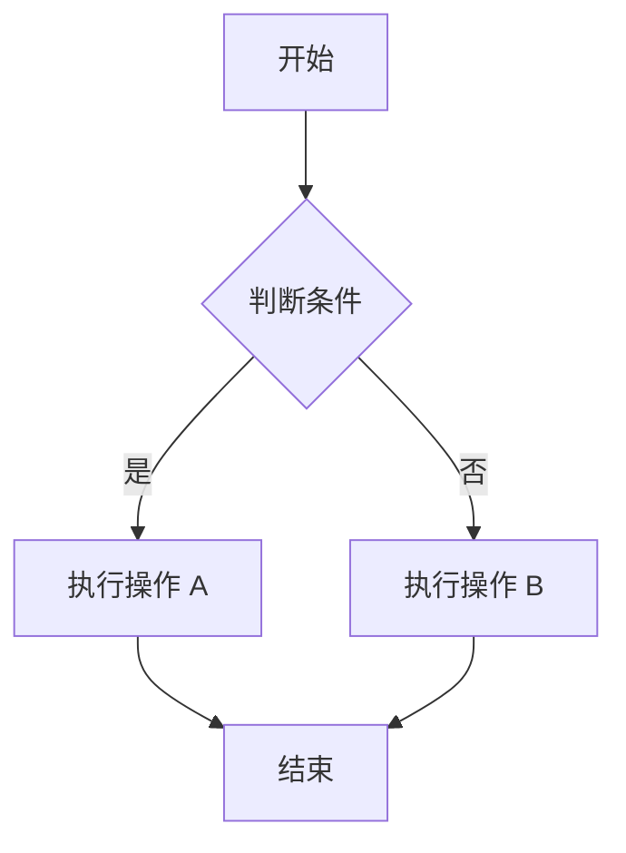
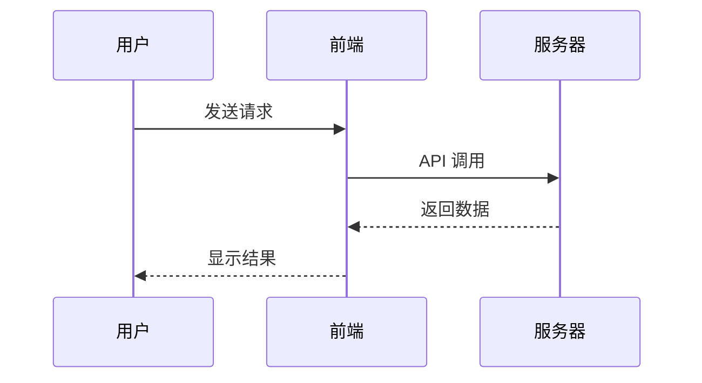
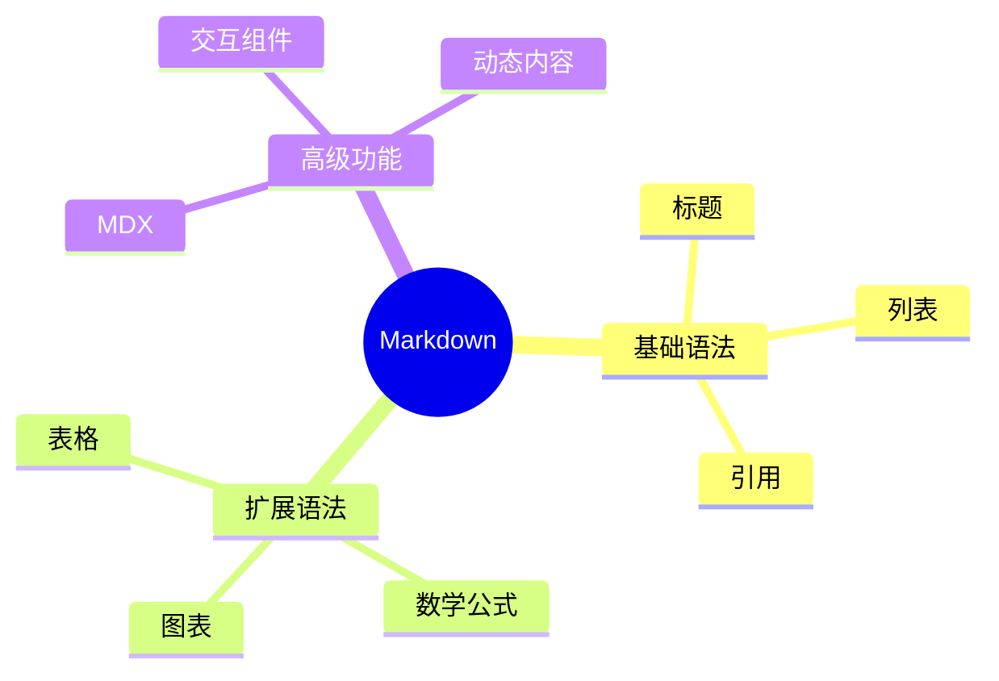
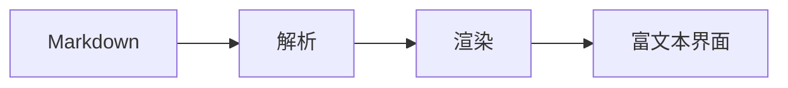

# 一级标题 H1
## 二级标题 H2
### 三级标题 H3
#### 四级标题 H4
##### 五级标题 H5
###### 六级标题 H6

---

## 1. 文字样式

普通文本

**粗体文字**

*斜体文字*

***粗斜体文字***

~~删除线~~

<u>下划线</u>

==高亮文字==

`行内代码`

H~2~O

X^2^

上标：<sup>2</sup>

下标：<sub>2</sub>

快捷键：<kbd>Ctrl</kbd> + <kbd>C</kbd>

---

## 2. 引用块

> 普通引用

> 第一层引用
>> 第二层引用
>>> 第三层引用

---

## 3. 列表

- 无序列表
- 第二项
  - 子项目 A
  - 子项目 B

1. 有序列表
2. 第二步
3. 第三步

### 任务列表

- [x] 已完成
- [x] 已检查
- [ ] 待处理
- [ ] 待发布

---

## 4. 链接

[OpenAI](https://openai.com)

<https://example.com>

[带标题的链接](https://example.com "提示文字")

---

## 5. 图片


[](https://images.unsplash.com/photo-1470770841072-f978cf4d019e?auto=format&fit=crop&w=1400&q=90)

---

## 6. 表格

| 名称 | 类型 | 状态 |
|:---|:---:|---:|
| Markdown | 文档 | ✅ |
| Mermaid | 图表 | ✅ |
| MDX | 组件 | 🚀 |

---

## 7. 代码块

```python
def hello(name):
    return f"Hello, {name}!"

print(hello("World"))
```

```javascript
const user = {
  name: "Alice",
  age: 20,
  active: true
};

console.log(user);
```

```json
{
  "name": "Markdown",
  "version": "1.0",
  "enabled": true
}
```

```diff
- const oldValue = 10;
+ const newValue = 20;
```

---

## 8. 数学公式

行内公式：

$E = mc^2$

块级公式：

$$
E = mc^2
$$

积分：

$$
\int_{-\infty}^{+\infty} e^{-x^2} dx
= \sqrt{\pi}
$$

矩阵：

$$
A =
\begin{bmatrix}
1 & 2 & 3 \\
4 & 5 & 6 \\
7 & 8 & 9
\end{bmatrix}
$$

---

## 9. Mermaid 流程图



---

## 10. Mermaid 时序图



---

## 11. Mermaid 甘特图


---

## 12. Mermaid 思维导图



---

## 13. 提示块（GitHub 风格）

> [!NOTE]
> 这是普通提示信息。

> [!TIP]
> 这是实用技巧。

> [!IMPORTANT]
> 这是重要内容。

> [!WARNING]
> 这是警告信息。

> [!CAUTION]
> 这是危险操作提醒。

---

## 14. 折叠面板（HTML 扩展）

<details>
<summary>点击展开内容</summary>

这里是隐藏内容。

可以放文字、代码和其他元素。

</details>

---

## 15. 脚注

这里是一段带脚注的文字。[^1]

[^1]: 这是脚注内容。

---

## 16. 定义列表（Pandoc 等扩展）

Markdown
: 一种轻量级标记语言

MDX
: 允许在 Markdown 中嵌入组件的格式

---

## 17. Emoji

😀 😎 🚀 🔥 💡

✅ ❌ ⚠️ 📌 ⭐

📊 📈 📉 💻 🎨

---

## 18. HTML 混合排版

<div align="center">

### 居中标题

这是一段居中文字。

</div>

<mark>高亮文字</mark>

<small>小号文字</small>

<del>删除文字</del>

<ins>插入文字</ins>

---

## 19. 目录锚点

[跳转到文字样式](#1-文字样式)

[跳转到代码块](#7-代码块)

---

## 20. MDX 卡片组件


这是卡片的正文内容。


---

## 21. MDX 标签页



```python
print("Hello")
```


```javascript
console.log("Hello");
```



---

## 22. MDX 交互按钮

点击按钮

次要按钮

---

## 23. MDX 进度条



---

## 24. MDX 徽章

成功

处理中

失败

---

## 25. MDX 警告框

操作成功！

请检查输入内容。

发生错误。

---

## 26. MDX 网格布局


内容 A
内容 B
内容 C


---

## 27. MDX 图表组件



---

## 28. MDX 交互表单



---

## 29. 分割线

---

***

___

---

## 30. 综合展示

# 🚀 现代 Markdown 展示

> [!IMPORTANT]
> 这是一个综合示例。

### 功能进度

- [x] 基础排版
- [x] 代码高亮
- [x] 数学公式
- [x] 图表支持
- [ ] 动态交互

### 数据统计

| 指标 | 数值 | 趋势 |
|---|---:|---|
| 用户量 | 12,500 | 📈 |
| 访问量 | 88,000 | 📈 |
| 错误率 | 0.2% | 📉 |

### 流程



### 数学表达

$$
f(x)=\frac{1}{1+e^{-x}}
$$

**完成！**
