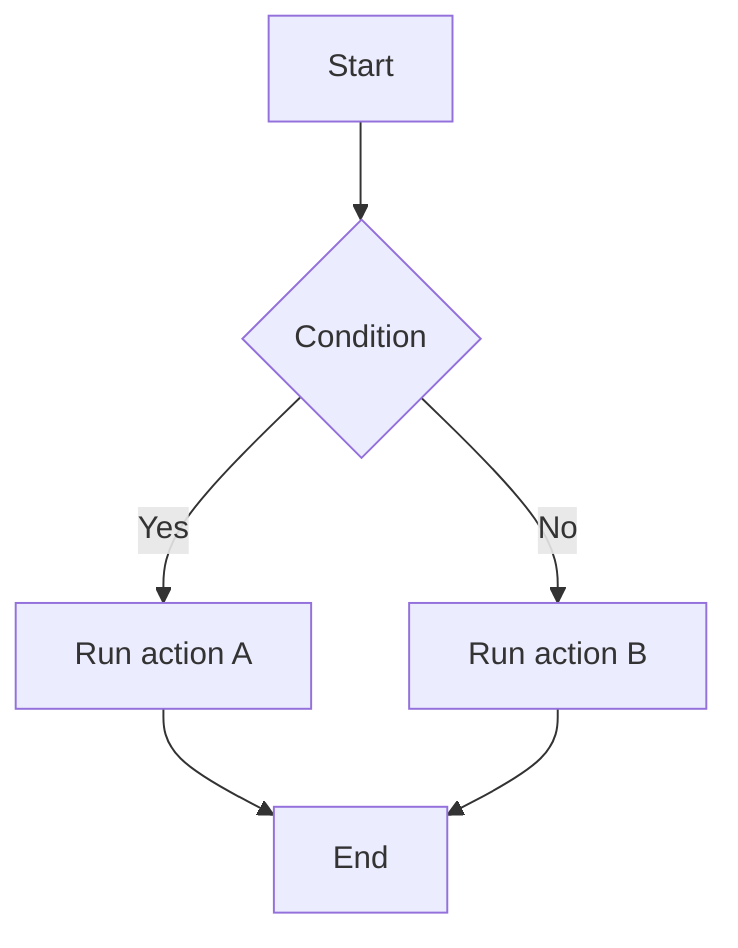
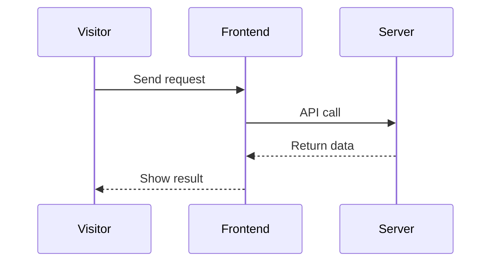
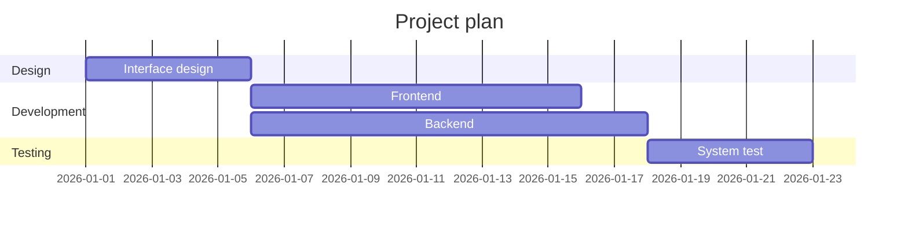
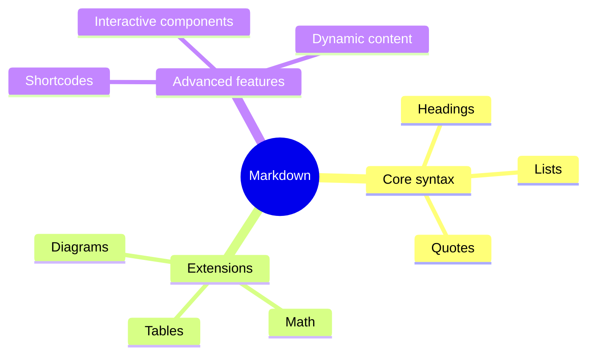
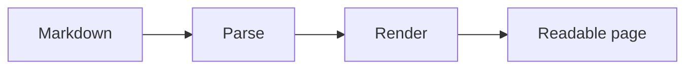

# Heading level 1
## Heading level 2
### Heading level 3
#### Heading level 4
##### Heading level 5
###### Heading level 6

---

## 1. Text formatting

Regular text

**Bold text**

*Italic text*

***Bold italic text***

~~Strikethrough~~

<u>Underline</u>

==Highlighted text==

`Inline code`

H~2~O

X^2^

Superscript: <sup>2</sup>

Subscript: <sub>2</sub>

Keyboard shortcut: <kbd>Ctrl</kbd> + <kbd>C</kbd>

---

## 2. Blockquotes

> A regular quote

> First-level quote
>> Second-level quote
>>> Third-level quote

---

## 3. Lists

- Unordered item
- Second item
  - Nested item A
  - Nested item B

1. Ordered item
2. Step two
3. Step three

### Task list

- [x] Completed
- [x] Reviewed
- [ ] To do
- [ ] To publish

---

## 4. Links

[OpenAI](https://openai.com)

<https://example.com>

[Link with a title](https://example.com "Link title")

---

## 5. Images


[](https://images.unsplash.com/photo-1470770841072-f978cf4d019e?auto=format&fit=crop&w=1400&q=90)

---

## 6. Tables

| Name | Type | Status |
|:---|:---:|---:|
| Markdown | Document | Ready |
| Mermaid | Diagram | Ready |
| Hugo | Site generator | Ready |

---

## 7. Code blocks

```python
def hello(name):
    return f"Hello, {name}!"

print(hello("World"))
```

```javascript
const user = {
  name: "Alice",
  age: 20,
  active: true
};

console.log(user);
```

```json
{
  "name": "Markdown",
  "version": "1.0",
  "enabled": true
}
```

```diff
- const oldValue = 10;
+ const newValue = 20;
```

---

## 8. Math

Inline formula: $E = mc^2$

Display formula:

$$
E = mc^2
$$

Integral:

$$
\int_{-\infty}^{+\infty} e^{-x^2} dx = \sqrt{\pi}
$$

Matrix:

$$
A =
\begin{bmatrix}
1 & 2 & 3 \\
4 & 5 & 6 \\
7 & 8 & 9
\end{bmatrix}
$$

---

## 9. Mermaid flowchart



---

## 10. Mermaid sequence diagram



---

## 11. Mermaid Gantt chart



---

## 12. Mermaid mind map



---

## 13. GitHub-style callouts

> [!NOTE]
> This is a note.

> [!TIP]
> This is a useful tip.

> [!IMPORTANT]
> This is important.

> [!WARNING]
> This is a warning.

> [!CAUTION]
> Use care when performing this action.

---

## 14. HTML disclosure

<details>
<summary>Click to expand</summary>

This content is hidden until expanded. You can put text, code, and other elements here.

</details>

---

## 15. Footnotes

Here is a sentence with a footnote.[^1]

[^1]: This is the footnote.

---

## 16. Definition lists

Markdown
: A lightweight markup language.

Hugo shortcodes
: Reusable components embedded in Markdown content.

---

## 17. Symbols

Arrows: ← ↑ → ↓ · — …

Mathematical symbols: ∑ ∫ √ ∞ ≈ ≠ ≤ ≥

---

## 18. Mixed HTML layout

<div align="center">

### Centered heading

This paragraph is centered.

</div>

<mark>Highlighted text</mark>

<small>Small text</small>

<del>Deleted text</del>

<ins>Inserted text</ins>

---

## 19. Table of contents anchors

[Jump to text formatting](#1-text-formatting)

[Jump to code blocks](#7-code-blocks)

---

## 20. Hugo card shortcode


This is the body of the card.


---

## 21. Hugo tabs shortcode



```python
print("Hello")
```


```javascript
console.log("Hello");
```



---

## 22. Hugo buttons

Primary action

Secondary action

---

## 23. Hugo progress bar



---

## 24. Hugo badges

Success

In progress

Failed

---

## 25. Hugo alerts

The operation succeeded.

Please check the input.

An error occurred.

---

## 26. Hugo grid


Content A
Content B
Content C


---

## 27. Chart shortcode



---

## 28. Interactive form shortcode



---

## 29. Horizontal rules

---

***

___

---

## 30. Combined example

# A modern Markdown showcase

> [!IMPORTANT]
> This combines several features in one example.

### Feature checklist

- [x] Basic formatting
- [x] Syntax highlighting
- [x] Mathematical formulas
- [x] Diagrams
- [ ] Interactive content

### Sample metrics

| Metric | Value | Trend |
|---|---:|---|
| Readers | 12,500 | Rising |
| Visits | 88,000 | Rising |
| Error rate | 0.2% | Falling |

### Flow



### Formula

$$
f(x)=\frac{1}{1+e^{-x}}
$$

**Done!**
